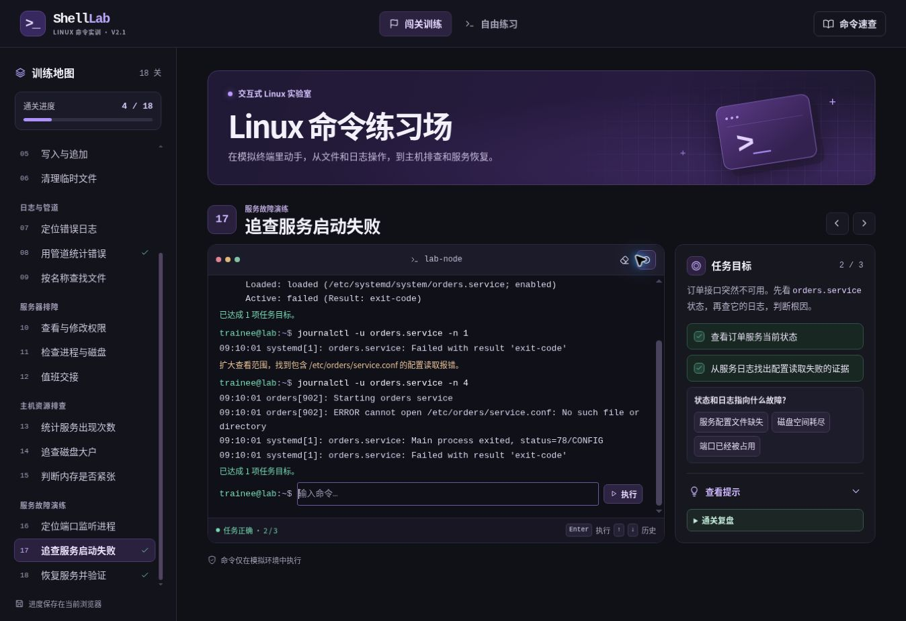
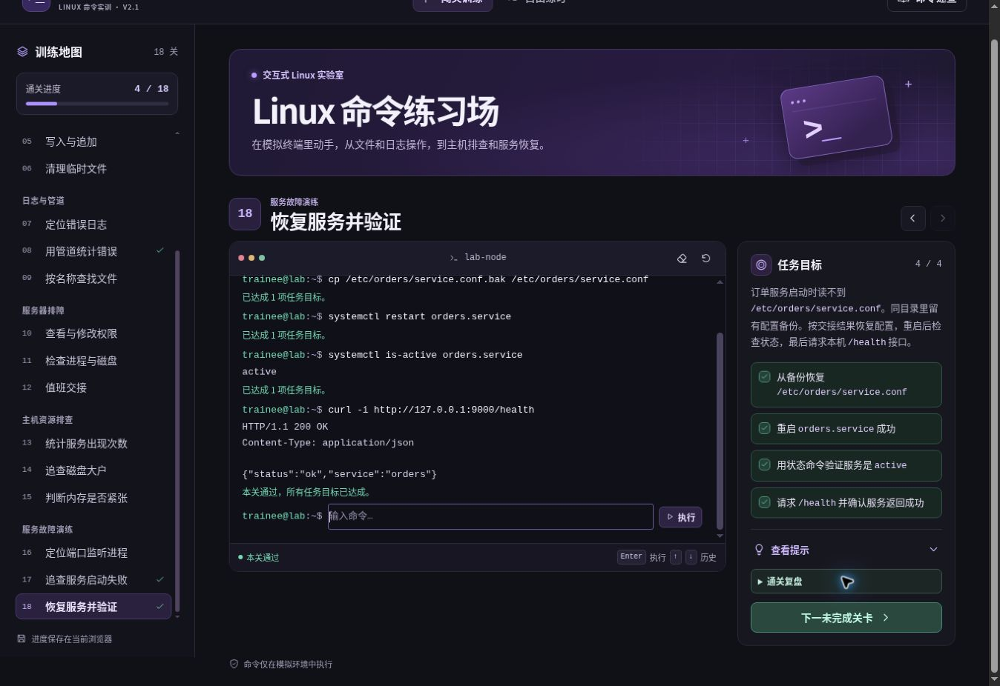
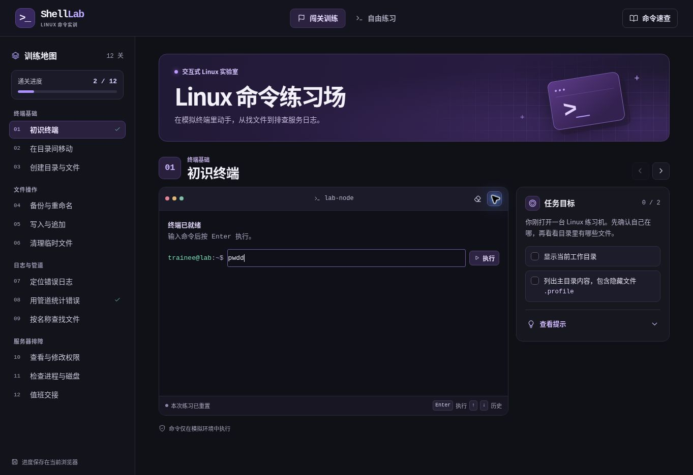
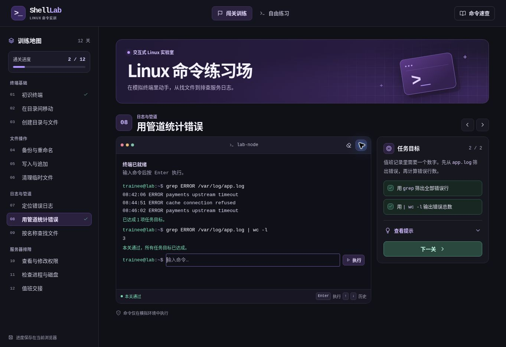

# Shell Lab · Linux 命令练习场

Shell Lab 是一个中文 Linux 练习场。你可以在模拟终端里输入命令、查看输出，并按任务目标逐项通关。

| 版本 | 关卡 | 使用方式 |
| --- | --- | --- |
| 在线版 V2.1 | 18 关 | [打开练习场](https://shell-lab-linux-gj.liukangjie686.chatgpt.site)，需要获授权的 ChatGPT 账号 |
| 仓库版 V1.0.0 | 12 关 | 下载仓库，用浏览器打开 <code>index.html</code> |

## 在线版 V2.1

- **判分**会核对命令读取的实际文件。日志题需要对指定的日志完成筛选，输出数字正确只是其中一项。
- **错因提示和复盘**覆盖 18 关。诊断题需要先查看终端证据，回答错误时会提示该回看哪条线索。
- **服务故障演练**从查状态、读日志开始，继续恢复配置、重启服务，并用 <code>curl</code> 验证本机模拟健康接口。
- 通关进度保存在当前浏览器，使用同一浏览器和网址可以继续练习。

### 第 17 关 · 追查服务启动失败

先用 <code>systemctl</code> 查看服务状态，再用 <code>journalctl</code> 找到配置文件读取失败的日志。获得两项证据后才能回答根因。

### 第 18 关 · 恢复服务并验证

恢复配置并重启后，分别检查服务状态和模拟 HTTP 接口。终端返回 <code>200 OK</code> 后，完成健康检查并查看通关复盘。

## 本地运行 V1

1. 用浏览器打开仓库根目录的 <code>index.html</code>。
2. 从左侧训练地图选择关卡，在终端输入命令并按 **Enter**。第一关可以先试 <code>pwd</code>。
3. 右侧复选标记显示达成的目标。「查看提示」会解释用法，点击示例可以将命令填进终端。

页面提供 **12 关**，覆盖目录导航、文件操作、日志筛选、管道、权限、进程和磁盘检查。另有自由练习模式和可搜索的命令速查。通关与关卡状态保存在当前浏览器，使用同一地址可继续。

V1 基础关卡截图

### 命令报错与逐项反馈

输错命令会看到具体错误。成功执行 <code>pwd</code> 后，右侧目标打勾并显示 **1 / 2**。提示会解释如何显示隐藏文件，并提供可填入终端的示例。

### 用管道完成一关

第 8 关筛出日志中的错误，再用管道把结果交给 <code>wc -l</code>。初始日志包含 3 条错误。两个目标都达成后，页面显示「本关通过」。

## 练习环境

页面在浏览器中模拟文件系统、命令、权限和进程。所有数据是练习用的虚拟数据。可用命令和选项见页面右上角「命令速查」。
